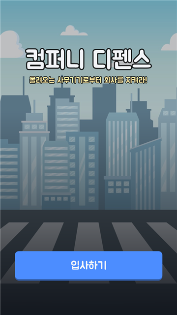
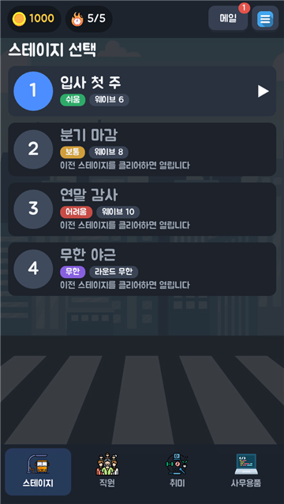
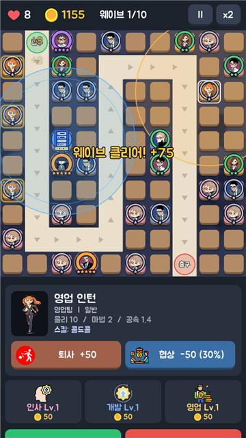
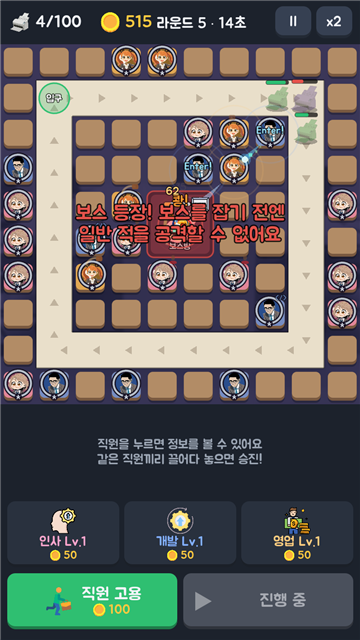

# 컴퍼니 디펜스

> 몰려오는 사무기기로부터 회사를 지켜라!

직원을 고용해 책상에 앉히고, 같은 직원끼리 합쳐 승진시키며 프린터·팩스·복합기 군단을 막아내는 모바일 디펜스 게임입니다.

<p align="center">
  
  
  
  
</p>

## 게임 소개

**직원 (타워)**
- 인사팀 · 개발팀 · 영업팀, 세 부서 18명의 직원
- 같은 직원 두 명을 끌어다 합치면 한 등급 위 직원으로 승진 (1~5등급)
- 직원마다 고유 스킬: 커피 수혈, 코드 해석, 대형 계약 등
- 책상 색은 부서, 발판 테두리와 별은 등급
- 보스를 잡으면 유물을 얻고, 유물로 특수 직원(AI 연구원 · 헤드헌터 · 엔젤 투자자)을 뽑을 수 있음

**적**

| 적 | 특징 |
|---|---|
| 프린터 · 팩스 · 복합기 · 서버 | 기본 적 (빠르거나 단단하거나) |
| 택배 상자 | 부수면 작은 상자 3개로 나뉨 |
| 정수기 | 주변 적의 체력을 회복 |
| 로봇청소기 | 빠르고, 기절과 감속에 걸리지 않음 |
| 노트북 | 보호막, 한동안 안 맞으면 다시 충전 |
| 전화기 | 벨이 울리면 근처 직원이 통화하느라 멈춤 |
| 부장님 프린터 | 보스 |

**스테이지**
1. 입사 첫 주 (쉬움)
2. 분기 마감 (보통)
3. 연말 감사 (어려움)
4. **무한 야근**: 적이 끝없이 고리를 돌고, 100마리가 쌓이면 끝. 5라운드마다 가운데 보스방에 보스가 나타나고, 보스를 잡기 전에는 일반 적을 공격할 수 없습니다.

**성장**
- 스테이지 보상 골드로 직원 레벨, 취미, 사무용품을 올려 능력치 강화

## 개발

- 엔진: [Godot 4.7.2](https://godotengine.org) (GDScript)
- 대상: Android (arm64)

```powershell
# PC 에서 실행
godot --path .

# 릴리스 APK 빌드 (build\CompanyDefense-v<버전>.apk)
powershell -File tools\build.ps1 -Version 2.2.3
```

서명 키는 저장소 밖 `..\keys` 에 두며, 커밋하지 않습니다.

### 폴더 구조

```
scenes/            화면 씬
scripts/
  autoload/        게임 데이터, 저장, 공용 UI
  screens/         타이틀, 메인 화면, 탭
  stage/           전투 (Battle, BattleView, 타워, 적, 스킬, 스테이지 정의)
assets/            그림과 게임 데이터 (assets/data/gamedata.json)
tools/
  build.ps1        APK 빌드
  gen_characters.py  직원 그림(SVG) 생성기: python tools/gen_characters.py
  scenarios/       자동 플레이 · 스크린샷 · 밸런스 시뮬레이터
```

밸런스 시뮬레이터 (화면 없이 수백 판을 돌려 승률을 잰다):

```powershell
godot --headless --path . -- --dev-script=res://tools/scenarios/balance.gd --dev-out=<폴더> --dev-runs=40
```
